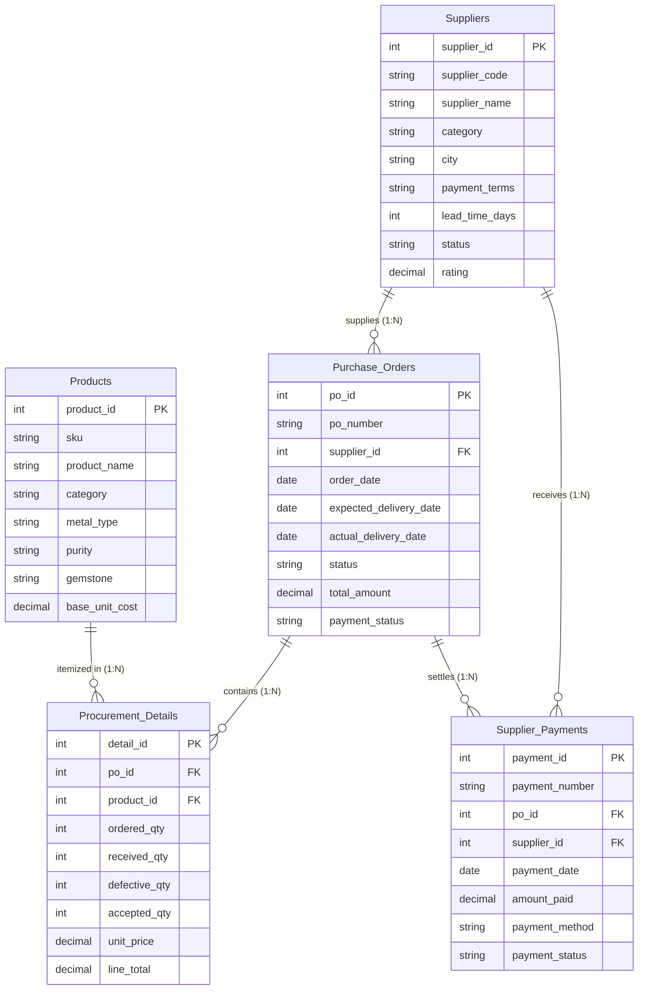

# Power BI Architecture & Data Modeling Guide

## 1. Overview & Objective

This guide documents the enterprise data modeling, direct MySQL database integration, and semantic schema design for creating executive Power BI reports for the **Supplier & Procurement Performance Analytics Platform**.

The Power BI data model connects directly to the identical MySQL relational database (`jewellery_procurement_db`) utilized by the React/Express web application, guaranteeing 100% data consistency between the web dashboard and Power BI analytical reports.

---

## 2. MySQL Connection Specifications

### Connection Parameters
- **Data Source**: MySQL Database / MySQL ODBC 8.0 Unicode Driver
- **Cloud Database (TiDB Cloud)**:
  - **Server**: `gateway01.ap-southeast-1.prod.aws.tidbcloud.com:4000`
  - **Database**: `jewellery_procurement_db`
  - **Username**: `43VuQDB9CLULgYi.root`
  - **Password**: *(Your TiDB Cloud password from .env)*
- **Local Database (Alternative)**:
  - **Server**: `127.0.0.1:3307` (or `localhost:3306`)
  - **Database**: `jewellery_procurement_db`

### Step-by-Step Connection in Power BI Desktop
1. Open **Power BI Desktop**.
2. Click **Get Data** → Select **MySQL database** → Click **Connect**.
3. In the Server field, input: `127.0.0.1:3307`.
4. In the Database field, input: `jewellery_procurement_db`.
5. Select **Import** mode.
6. Under Credentials, choose **Database**, enter username `root` and password (leave blank if default), then click **Connect**.
7. In the Navigator window, select the following 5 tables:
   - `Suppliers`
   - `Products`
   - `Purchase_Orders`
   - `Procurement_Details`
   - `Supplier_Payments`
   - *(Optional)* Select pre-built SQL Views: `vw_supplier_performance`, `vw_monthly_procurement`.
8. Click **Transform Data** (Power Query) to verify data types before loading.

---

## 3. Star Schema Data Model

The data model uses a Star / Snowflake dimensional architecture:



### Relationships & Cardinalities
| From Table (Many) | Foreign Key | To Table (One) | Primary Key | Cardinality | Cross Filter |
| :--- | :--- | :--- | :--- | :--- | :--- |
| `Purchase_Orders` | `supplier_id` | `Suppliers` | `supplier_id` | Many to One (*:1) | Single |
| `Procurement_Details` | `po_id` | `Purchase_Orders` | `po_id` | Many to One (*:1) | Both |
| `Procurement_Details` | `product_id` | `Products` | `product_id` | Many to One (*:1) | Single |
| `Supplier_Payments` | `po_id` | `Purchase_Orders` | `po_id` | Many to One (*:1) | Single |
| `Supplier_Payments` | `supplier_id` | `Suppliers` | `supplier_id` | Many to One (*:1) | Single |

---

## 4. Date Dimension (Calendar Table)

In Power BI Desktop, navigate to **Modeling** → **New Table** and paste this DAX formula to establish a standard Date Dimension:

```dax
Dim_Date = 
VAR MinDate = DATE(2025, 10, 1)
VAR MaxDate = DATE(2026, 12, 31)
RETURN
    ADDCOLUMNS(
        CALENDAR(MinDate, MaxDate),
        "Year", YEAR([Date]),
        "Month Number", MONTH([Date]),
        "Month Name", FORMAT([Date], "MMMM"),
        "Month Short", FORMAT([Date], "MMM"),
        "Year-Month", FORMAT([Date], "YYYY-MM"),
        "Quarter", "Q" & FORMAT([Date], "Q"),
        "Day of Week", FORMAT([Date], "dddd"),
        "Is Weekend", IF(WEEKDAY([Date], 2) >= 6, "Weekend", "Weekday")
    )
```

Link `Dim_Date[Date]` (1) to `Purchase_Orders[order_date]` (*).

---

## 5. Metric Consistency Verification

To ensure parity with the web dashboard, verify that DAX calculations match MySQL SQL View calculations:

| Metric | Web App (SQL View) | Power BI (DAX Measure) | Expected Match |
| :--- | :--- | :--- | :--- |
| **Total Spend** | `SUM(po.total_amount)` | `SUM(Purchase_Orders[total_amount])` | Identical to 2 decimals |
| **On-Time Delivery Rate** | `(on_time_orders / completed_orders) * 100` | `DIVIDE([On-Time Orders], [Delivered Orders]) * 100` | Identical |
| **Defect Rate** | `(defective_qty / received_qty) * 100` | `DIVIDE([Total Defective], [Total Received]) * 100` | Identical |
| **Reliability Score** | `(OTD * 0.40) + (Quality * 0.35) + (Fulfilment * 0.25)` | `([OTD Rate] * 0.40) + ([Quality Score] * 0.35) + ([Fulfilment Rate] * 0.25)` | Identical |
